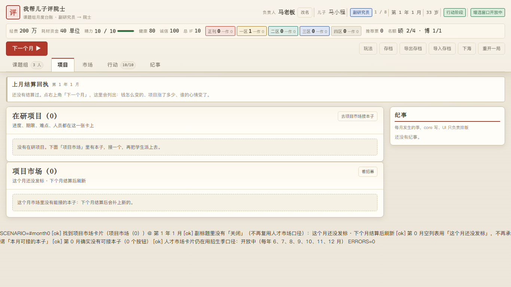
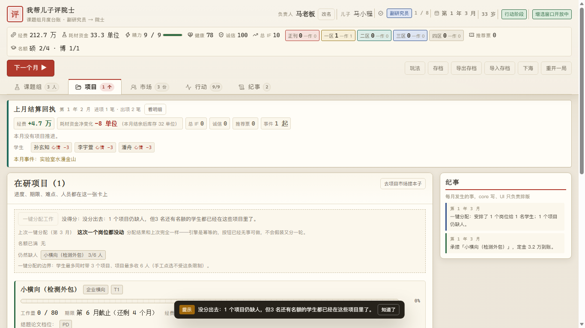
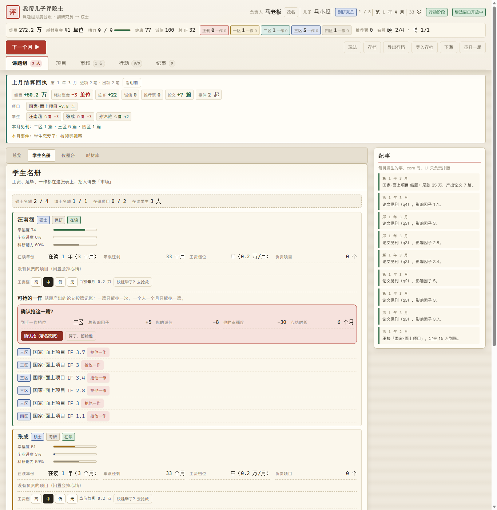
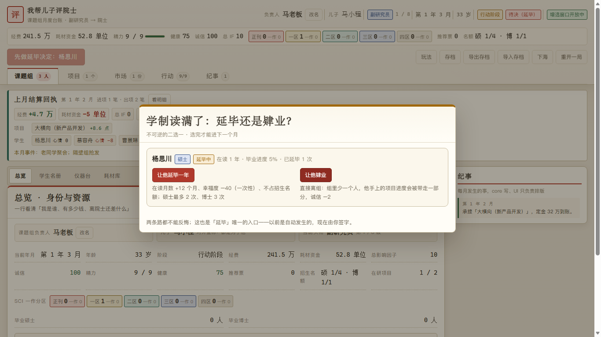
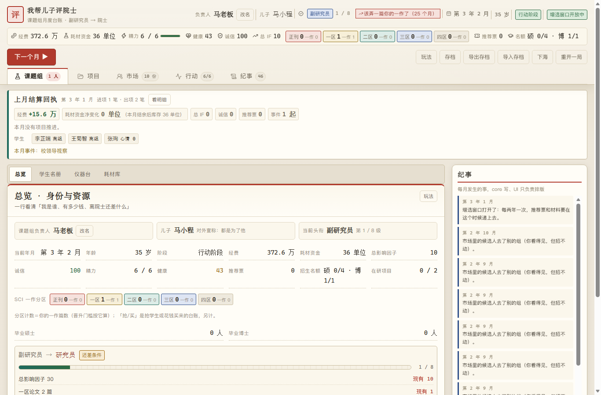
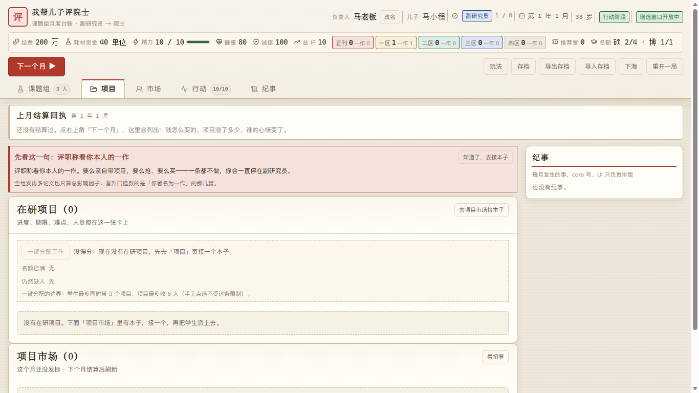
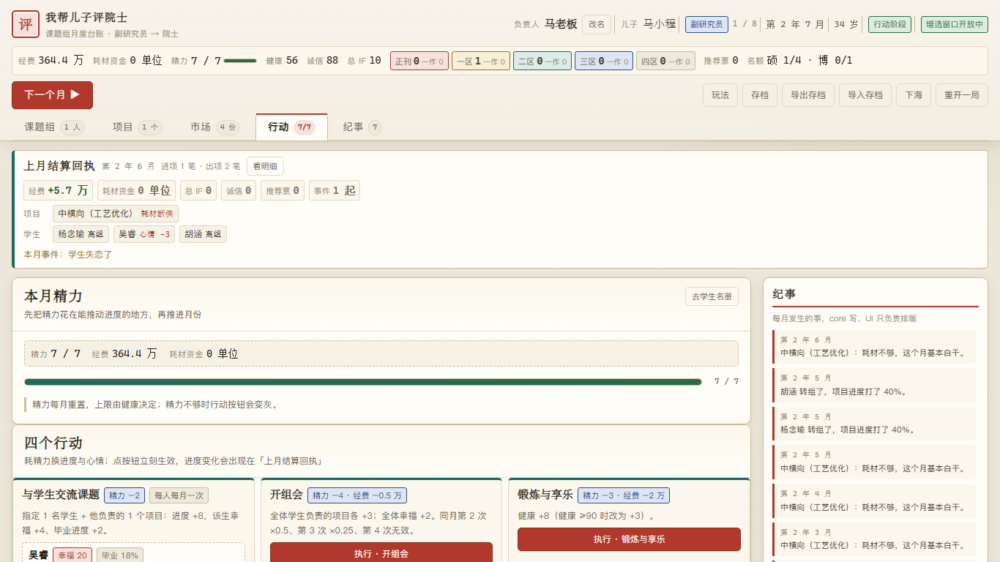
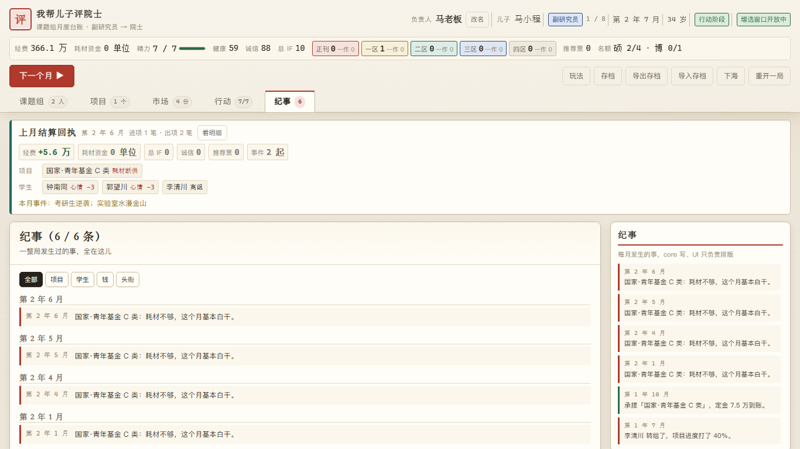

# 我帮儿子评院士

**一句话**：你扮演课题组大老板，经营经费 / 设备 / 学生 / 项目，把「儿子」马小程从副研究员一路刷成院士。网页养成经营小游戏，纯前端零构建，双击即玩。



## 玩法概述

- **核心循环**：看市场 → 接项目（定金到账）→ 排兵布阵（分配学生、买设备、采购耗材）→ 推进月份（推进度、处理难点、应付事件）→ 结题发表（拿尾款、出论文）→ 攒够条件晋升。
- **八级头衔**：副研究员 → 研究员 → 副教授 → 教授 → 优青/万人 → 杰青/长江（单有）→ 杰青+长江（兼有）→ **院士**。院士硬门槛 = 总 IF ≥1400 + 一区一作 ≥16 + 正刊 ≥3 + ≥3 张推荐票 + ≥45 岁 + 增选窗口 + T6 结题 ≥1 且 T5+ 结题 ≥2。
- **一作才是硬通货**（本作的核心机制）：**晋升只认你本人署名的一作**，学生一作只涨总 IF。三条来源：
  1. **亲带**（「我亲自带」）：论文一作全是你的，代价是项目推进 ×0.85、每月多花 1 点精力；
  2. **买**：一作交易台花钱买署名，越厉害的刊物越贵，掉一点诚信；
  3. **抢**：抢学生的一作，快，但诚信 −8、该生幸福 −30、结下 6 个月心结。
- **实验室空间（v1.2 新增）**：仪器不再是点一下就到手——先得有地方放。实验室按「房间 × 台位」展开，实验台要花钱买（标准 8 格 4 万 / 大型 12 格 12 万），**仪器占格**（水浴锅、离心机 1×1；摇床、超净台、酶标仪、凝胶成像 2×1；液相、气相 2×2；质谱 3×2），放不下就是放不下。支持旋转、搬动、拆台卖设备；实验室最多 4 间，按头衔解锁。
- **课题组经营**：12 台仪器（各有小幅/大幅加成；v1.2 新增 **AKTA 蛋白纯化 / 紫外分光光度计 / PCR 仪 / 凝胶成像**，并配了需要它们才能承接的项目）、耗材资金（1 单位 = 1 万元；三种消耗模式：随意挥霍 / 正常 / 收紧裤腰）、学生幸福度（低于 0 会转组，转组会把他在研项目的进度打回 40%）、**多带项目每月额外掉幸福度**（带 3 个 −2/月）、延毕要你签字、抢一作按篇二次确认。
- **手机端（v1.2 重排）**：顶部只留关键资源、导航收成 5 项、学生与项目详情默认折叠、实验室按房间→台位逐层展开；仪器目录改成选择而不是长列表，**不依赖 hover 或拖拽**，触控目标 ≥44px。
- **会输**：诚信归零 → 被举报；学生全散 → 实验室空；钱烧光 → 破产；健康归零 → 住院；也可以主动下海（结局记进纪事）。

## 三种入口

| 入口 | 怎么做 | 适合 |
|---|---|---|
| **① 双击即玩**（推荐） | 打开 `dist/wobang-son-academician.html` —— 自包含单文件，内联 CSS/JS、零外部引用，不联网也能玩 | 只想玩一下 / 离线 / 发给别人 |
| **② 本地起服务** | `node server.mjs` → 打开 <http://127.0.0.1:5175/> | 改代码、看效果 |
| **③ 在线玩** | <https://issac0205.github.io/wobang-son-academician/> | 手机/别人电脑上打开（**见下方「已知限制」：本机没能验证这条链路**） |

## 截图

| 开局台账 | 项目与难点 | 抢一作确认 | 延毕签字 |
|---|---|---|---|
|  |  |  |  |

| 一作空窗提示 | 首次进项目页引导 | 行动页 | 纪事 |
|---|---|---|---|
|  |  |  |  |

更多（含市场「0 可接」分支、帮助弹层、无存档首屏）见 [`docs/screenshots/`](docs/screenshots/README.md)。

## 项目结构

```
评院士/
├── index.html               # 源码版入口（配合 server.mjs，模块化加载）
├── server.mjs               # 零依赖静态服务器（127.0.0.1:5175）
├── src/
│   ├── data/                # ★ 全部可调数值（头衔/项目/仪器/论文/学生/事件/结局…）12 个文件，零 import
│   ├── core/                # 规则与状态机（state / rules / formulas / engine / save / viewmodel…）
│   ├── ui/                  # 视图与组件（只读 core 给的 viewmodel，不含游戏数值）
│   ├── styles/              # 样式（设计令牌集中在 :root）
│   └── systems/bots.js      # 无头模拟用的机器人策略（含各对照配置）
├── scripts/                 # check / simulate / ui-smoke / build-single / asset-audit / version
├── tests/                   # 断言脚本（run-all.mjs 一次跑完）
├── dist/                    # 构建产物：自包含单文件（提交进仓库，双击即玩）
├── docs/                    # 设计/契约/数值/验证文档 + 截图（另含 Pages 兜底页 index.html）
├── versions/                # 版本存档：每个版本一份可双击快照 + 溯源
└── artifacts/verification/  # 独立验证的探针与浏览器实测证据
```

## 改数值看哪（最常见的问题）

> **改数值只动 `src/data/*`；改规则动 `src/core/*`；接口契约在 `docs/CONTRACT.md`。**

| 想改什么 | 去哪个文件 |
|---|---|
| 头衔门槛 / 名额 / 校拨经费 | `src/data/ranks.js` |
| 项目模板（工期、工作量、钱、耗材、仪器要求） | `src/data/projects.js` |
| 仪器价格与加成、初始持有量 | `src/data/instruments.js` |
| 论文档位与 IF、买/抢一作的代价 | `src/data/papers.js` |
| 学生幸福度、工资、毕业与离组规则 | `src/data/students.js` |
| 市场席位 / TTL / 供给下界 / 招生季 | `src/data/market.js` |
| 事件文案与效果 | `src/data/events.js` |
| 结局条件与文案 | `src/data/endings.js` |
| 消耗模式、初始资源、退休与破产线 | `src/data/tuning.js` |

改完跑一遍自检（见下）；数值口径与来源标注在 `docs/BALANCE.md`（每条都有 `[SPEC]` / `[研究]` / `[策划]` 标记）。

## 自检命令（发布门禁）

```bash
node 评院士/scripts/check.mjs          # 交付物/语法/导入/DOM 与交互契约/数据纯度/确定性/断言纪律
node 评院士/scripts/simulate.mjs       # 无头模拟曲线（平衡类读数为【信息性·非门禁】）
node 评院士/scripts/ui-smoke.mjs       # UI 结构 + 交互 + 存档回读（不需要浏览器）
node 评院士/tests/run-all.mjs          # 全部 7 个断言脚本
node 评院士/scripts/build-single.mjs   # 生成自包含单文件到 dist/
node 评院士/scripts/asset-audit.mjs    # 单文件外部引用审计（要求 0）
node 评院士/scripts/version.mjs        # 版本一览；--archive 归档 / --verify 校验哈希
```

## 文档索引

| 文档 | 用途 |
|---|---|
| [`docs/SPEC.md`](docs/SPEC.md) | 原始需求（唯一权威范围） |
| [`docs/GDD.md`](docs/GDD.md) | 游戏设计文档（玩法/循环/文案/界面） |
| [`docs/BALANCE.md`](docs/BALANCE.md) | 全部可调数值 + 平衡裁定记录（含「机器人读数非门禁」的决策） |
| [`docs/ARCHITECTURE.md`](docs/ARCHITECTURE.md) | 分层与数据流 |
| [`docs/CONTRACT.md`](docs/CONTRACT.md) | 模块边界与接口契约（冻结） |
| [`docs/LAB-SPACE.md`](docs/LAB-SPACE.md) | 实验室空间系统设计（网格/占格/价格/旧档迁移，v1.2） |
| [`docs/RESEARCH.md`](docs/RESEARCH.md) | 职称/经费/院士增选的真实资料锚点 |
| [`docs/VERIFICATION.md`](docs/VERIFICATION.md) | 独立验证报告（两轮）与 verdict |
| [`docs/DEV.md`](docs/DEV.md) | 非程序员也能照着做的开发/自检手册 |
| [`docs/CHANGELOG.md`](docs/CHANGELOG.md) | 版本条目 + 契约变更记录 |
| [`docs/ASSETS.md`](docs/ASSETS.md) | 素材清单与许可证 |

## 版本存档

**当前发布：v1.2.1**（2026-10-16 上线）。已归档版本：v1.0.0 / v1.0.1 / v1.1.0 / v1.2.0 / v1.2.1。

每个发布版本都在 `versions/vX.Y.Z/` 留档，里面是**可双击即玩的自包含单文件副本 + 一页说明 + `PROVENANCE.json` 溯源**（src 聚合哈希、单文件 SHA-256/字节数、check/simulate 退出码、验证 verdict）。约定与用法见 [`versions/README.md`](versions/README.md)；当前版本：[`versions/v1.0.0/`](versions/v1.0.0/)（直达单文件：`versions/v1.0.0/wobang-son-academician.html`）。

## 已知限制（如实）

1. **在线入口已实测可用（2026-10-16 复核）**：本机 hosts 把 github 域名指向 `127.0.0.1`（Watt Toolkit 反代），git 需走系统证书库 —— `git -c http.sslBackend=schannel push` 配合 Windows 凭据管理器可正常推送；`main` 与 tag 均已上传成功，在线单文件已下载回来与本地 `docs/index.html` **SHA-256 完全一致**。**仍未验证的只有 `.github/workflows/pages.yml`**（Actions 在本机跑不了）——但仓库里放了兜底页 `docs/index.html`，Pages 源选 main 分支 `/docs` 即可，不依赖 Actions。推送步骤见 [`PUSH.md`](PUSH.md)。
2. **平衡/通关率类读数是【信息性·非门禁】**：全部来自 AI 机器人，打法与真人不同；数值（含门槛与区间）待真人试玩后重定。依据见 `docs/BALANCE.md` §18.19。
3. 市场「可接 offer 数」分支（构造态文案）只有实现者自身截图 + `ui-smoke` 覆盖，**没有独立浏览器复核**。
4. 其余未闭合项与未验证项：见 `docs/VERIFICATION.md` 的 R11（含 GitHub Pages、真人试玩、机器人发薪策略等）。

## 许可证

[MIT](LICENSE) © 2026 Issac0205

## 致谢

设计范式借鉴了两个同为 MIT 许可的开源项目 —— [QualityCampusTheGame](https://github.com/kaiwang0112006/QualityCampusTheGame)（MIT，数据驱动的事件引擎、满意度平滑与天赋上限）与 [PhD Simulator](https://github.com/kangruixiang/PhD-Simulator)（MIT，事件 DSL 与时间推进结构）；**只借鉴设计思路，未复制其任何代码、文案或美术素材**。界面图标部分取自 [Lucide](https://lucide.dev/)（ISC 许可证），完整素材清单见 [`docs/ASSETS.md`](docs/ASSETS.md)。
